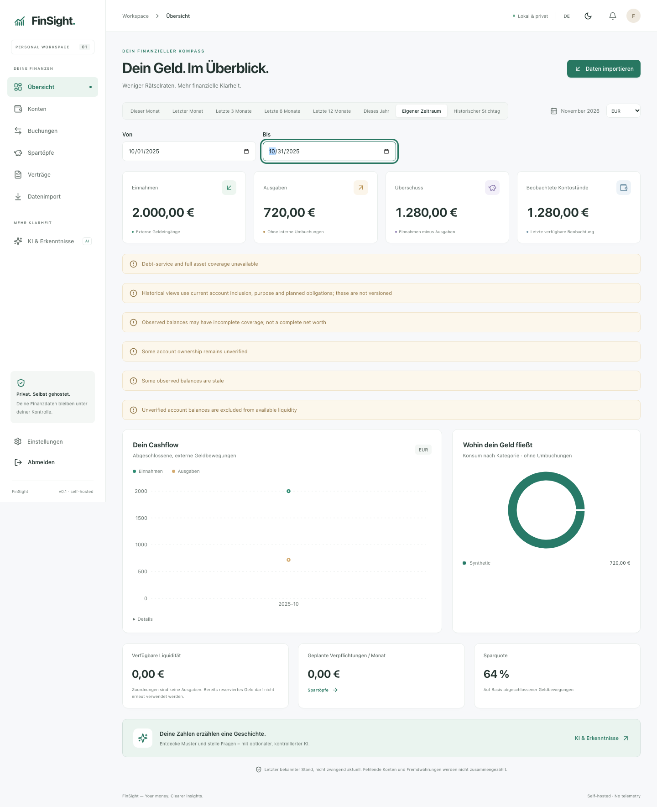

# FinSight

### Your money. Clearer insights.

Self-hosted, open-source personal finance intelligence: Finanzguru XLSX imports, currency-aware analytics, earmarked savings, recurring costs and opt-in AI explanations.

**Early release:** review [release status](docs/release-status.md) before relying on financial figures or deploying. This is not financial advice or an independently audited security product. FinSight is independent and unaffiliated with Finanzguru.

## What it is for

- Keep financial exports on infrastructure you control.
- Distinguish actual spending from internal transfers and savings allocations.
- Plan irregular annual obligations without double-counting contributions.
- Explore transactions while preserving their source evidence.
- Optionally ask a bounded agent to explain deterministic financial analyses, with cost controls and explicit provider consent.
- Connect an external assistant through opt-in, read-only MCP with OAuth consent, revocable scopes and reusable analysis prompts.

German is the default interface language; English is available. Default formatting is EUR / Europe/Berlin. Different currencies are reported separately, never silently combined.

<details>
<summary>Dashboard preview — synthetic data only</summary>



[Mobile preview](docs/screenshots/mobile.png). No actual financial export is shown.

</details>

## Quick start: Docker Compose

Requirements: Docker Engine/Desktop with Compose v2, a modern browser, and private storage for the database. Do not place your financial export in a public Git repository.

```sh
git clone https://github.com/philiplorenz-code/finsight.git
cd finsight
cp .env.example .env
openssl rand -hex 32
openssl rand -hex 32
```

Set **different** generated values for `POSTGRES_PASSWORD` and `FINSIGHT_BOOTSTRAP_SECRET` in `.env`. Password values generated as hex avoid connection-URL escaping issues. Then:

```sh
docker compose up -d --build
```

Open <http://localhost:8080>. Create the owner account using the bootstrap secret, then upload your XLSX from **Import**. The API, worker and database are not published as host ports. Keep the default loopback bind unless using a properly configured HTTPS reverse proxy. For HTTPS set `FINSIGHT_COOKIE_SECURE=true` and configure the canonical application URL.

Never run `docker compose down --volumes` against data you wish to keep. Standard `docker compose down` preserves named volumes.

## Configuration

See [`.env.example`](.env.example) and [configuration](docs/deployment/configuration.md). AI and ntfy are off by default. Enabling external AI requires explicit consent, a model allowlist, known conservative EUR token prices and budgets. Provider charges may differ from application estimates. No implicit model escalation or telemetry is intended.

## Ask your finances through MCP

FinSight offers an optional **Streamable HTTP MCP server** at `https://your-host/mcp`, independent of its internal AI agent. Set `MCP_ENABLED=true`, use a reachable HTTPS `APP_URL` and secure session cookies, then add the endpoint to an MCP-capable assistant using OAuth. In FinSight, review the client and requested permissions before granting access. Manage and revoke connections under **Settings → MCP**.

- `finance:read`: currency-separated analyses, account coverage and planning views.
- Optional `finance:transactions`: bounded transaction-level evidence, not raw banking references or source rows.
- Typed read-only tools, documented financial definitions and view/filter descriptors.
- Native MCP **prompts** act as portable workflow “skills” for common financial reviews; client support for prompts and resources varies.

Authorization uses PKCE, short-lived access tokens and rotating refresh tokens. Connecting a client permits financial data to leave your server when that client queries it. Your assistant/provider's retention policy and fees apply; **FinSight's internal AI budgets do not limit external model charges**. Availability of custom MCP connections in ChatGPT depends on its current product and account capabilities. Protocol tests are not a claim of a verified live ChatGPT integration.

See [MCP setup](docs/mcp.md), [tools and workflows](docs/mcp-tools.md) and [OAuth security](docs/mcp-auth.md).

## Technology

- React, TypeScript, Vite, Tailwind, TanStack Query, React Router and Recharts.
- Python/FastAPI, SQLAlchemy, Alembic and PostgreSQL.
- Bounded XLSX ingestion with source preservation and synthetic regression fixtures.
- Optional LangGraph/LiteLLM agent, PostgreSQL background jobs and ntfy.
- Compose services: web proxy, API, migration job, worker and database.

Read [architecture](docs/architecture/overview.md), [financial semantics](docs/financial-model.md) and [AI design](docs/ai-agent.md).

## Documentation

| Topic | Guide |
|---|---|
| Requirements and acceptance | [Specification](docs/specification.md), [stories](docs/stories.md) |
| Actual implementation status | [Release status](docs/release-status.md) |
| Import behavior and reconciliation | [Finanzguru import](docs/finanzguru-import.md) |
| Configuration and troubleshooting | [Configuration](docs/deployment/configuration.md) |
| Backup and recovery | [Backup/restore](docs/deployment/backup-restore.md) |
| Privacy | [Privacy](docs/privacy.md), [security policy](SECURITY.md) |
| External assistants and reusable workflows | [MCP](docs/mcp.md), [tool reference](docs/mcp-tools.md), [authorization](docs/mcp-auth.md) |
| Development and tests | [Development](docs/development.md) |
| Contributing | [Contribution guide](CONTRIBUTING.md) |

## Security and data handling

The source export is private. Real financial data must never appear in fixtures, public issue reports, screenshots, logs or Git history. Backups contain sensitive information and require encryption and access controls. Outgoing aggregate AI input is still financial information: review your provider's retention and residency policies.

Before each public push run `python scripts/privacy_check.py --reviewed-images docs/screenshots/reviewed.json` and an independent secret scanner. The screenshot manifest approves only exact hashes of manually reviewed synthetic PNGs. See [SECURITY.md](SECURITY.md) for private vulnerability reporting. Initial deployment is single-owner; it is not a public multi-tenant finance service.

## License

[Apache-2.0](LICENSE). Third-party dependencies retain their respective licenses. No proprietary Finanzguru assets or actual financial exports are distributed.
