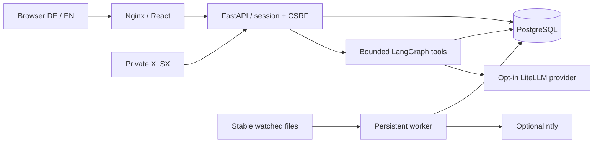

# Architecture

FinSight separates source evidence, deterministic finance and optional model interpretation.

## Trust boundaries

The browser is not an authorization boundary. Services scope records to the authenticated owner. Spreadsheet content is untrusted data, never code or model instructions. Source metadata may contain sensitive references and is not model input. The database and backup files are private. External AI and ntfy are separate trust domains requiring explicit configuration.

## Money and time

Monetary persistence uses NUMERIC and Python Decimal; APIs use decimal strings. Currency is part of every aggregate key. No implicit exchange rate converts currencies. Booking day is a date; import, audit and job times are UTC timestamps. Scheduling evaluates Europe/Berlin local time including daylight saving changes. Missing transaction status makes future bookings pending, not completed.

## Ingestion and evidence

Account identity comes from the source reference, not mutable display names. Stable booking identifiers scope deduplication to account and owner. Imports preserve source records and revisions; updates cannot overwrite user corrections. Reconciliation warns about uncertain splits, incomplete coverage and source transfer flags without opposite legs. An import is an observation, not proof that absent historical records were deleted at the bank.

## Runtime

Compose runs PostgreSQL, one migration job, API, worker and static web proxy. Only the web port is published, bound to loopback by default. Background jobs persist in PostgreSQL; PostgreSQL row locks are the production concurrency primitive. SQLite is used only for fast deterministic unit tests, not a replacement for production concurrency validation.

## Scope and provenance

The backlog is the target architecture, not a certification. See the release status for incomplete controls. No full wealth calculation can infer missing investments, debts or accounts. Inferred contracts and forecasts must disclose their uncertainty. AI text is explanatory, not financial advice or an automated payment instruction.
